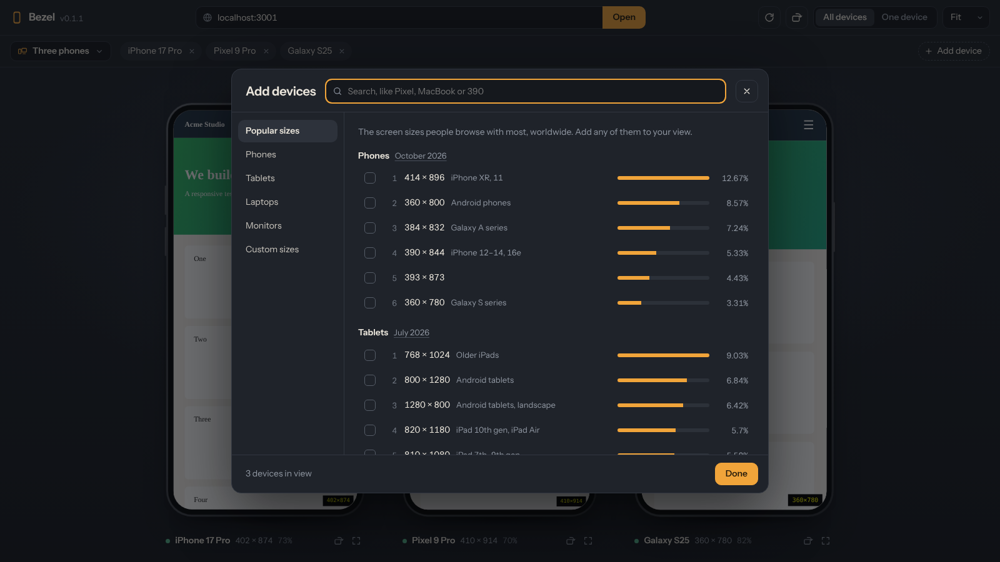

# Bezel

**See your website on every screen at once.**

**▶ Open Bezel: [zer0-red.github.io/Bezel](https://zer0-red.github.io/Bezel/)**. It runs in your browser, with nothing to install.
**⬇ Windows app: [download the latest release](https://github.com/Zer0-red/Bezel/releases/latest)**. Every site loads, with real phone emulation, and the app updates itself.

Bezel is a responsive testing tool for web development. Point it at your local dev server and preview your site on phones, tablets, laptops and monitors side by side. Each one is drawn as real hardware, and you can switch devices with one click while you work.


---

## Features

- **Setups**: one click for *Phone, tablet, laptop*, *Three phones*, *Phones, small to large*, *Most popular sizes*, *Apple*, *MacBooks* or *Tablets*. Save your own combinations with **Save current**.
- **Device library**: current iPhones (including iPhone 18 Pro Max and iPhone Air), Pixel and Galaxy phones, iPads, MacBook Air and Pro 13, 14, 15 and 16, Windows laptops and monitors. Search by name or size, such as `pixel` or `390`.
- **Popular screen sizes**: the most-used phone, tablet and desktop sizes worldwide, ranked with their share of browsing from StatCounter, and each one can be added with a click.
- **Real device frames**: phones with a Dynamic Island, notch, punch-hole camera or home button; tablets; laptops with their keyboard base; monitors on a stand.
- **All devices or one**: see every device side by side, or open one at full size and switch with the device bar.
- **Rotate**: switch phones, tablets and monitors between portrait and landscape.
- **Built for localhost**: type just `3000` and Bezel opens `http://localhost:3000`. If your dev server has hot reload, every device updates when you save.
- **Custom sizes**: add any width and height. Custom sizes and setups are saved on your computer.
- **Shareable links**: the address you're testing is kept in the page URL (`?url=…`).



## Web version or Windows app

Both have the same interface and are built from the same code.

| | Web version | Windows app |
|---|---|---|
| Install | Nothing, just open the link | One installer, then it updates itself |
| Sites it can show | Sites that allow framing (most local projects) | Any site, including Google and client sites |
| Phones and tablets | Exact screen size | Exact size **plus** mobile user agent, pixel density (2×–3.5×) and touch |
| Keyboard shortcuts | Only when Bezel's toolbar has focus | Also while you're clicking inside a device |
| Works on | Any computer or phone with a modern browser | Windows 10 and 11 |

### Installing the Windows app

1. Download `Bezel-Setup-x.y.z.exe` from [Releases](https://github.com/Zer0-red/Bezel/releases/latest) and run it.
2. Because the app isn't code-signed, Windows shows "Windows protected your PC" the first time. Click **More info**, then **Run anyway**.
3. That's it. Bezel checks for updates when it starts and every few hours. When a new version has downloaded, it offers **Restart to update**. If you just close Bezel, the update installs then.

## How it works

On the web, each device is an `<iframe>` set to the device's exact viewport size, then scaled with CSS to fit your screen. Your site sees the real viewport width, so media queries, container queries and breakpoints behave as they would on the device.

In the Windows app (Electron), each device is a real browser view instead of a frame, so sites can't refuse to be shown. Phones and tablets also get mobile emulation through Chrome's DevTools protocol (the same mechanism as DevTools' device mode): the device's user agent, pixel density, mobile viewport rules and touch input.

## Device sizes

Sizes are CSS-pixel viewports: what your media queries see at the device's default display setting. Laptop and monitor sizes are the whole screen; a browser window on them is a little shorter because of the menu bar and the browser's own toolbar. The full list is in [`src/devices.js`](src/devices.js).

Android phones let users change display size, which changes the viewport. To check your own phone, open a viewport checker in its browser (search for "what is my viewport") and compare it with the size Bezel shows. If it differs, add your phone as a custom size.

Popular sizes come from [StatCounter Global Stats](https://gs.statcounter.com/screen-resolution-stats) (worldwide). To refresh them, edit the `POPULAR` lists in `src/devices.js`.

## Getting started (development)

Requirements: **Node.js 20+**

```bash
git clone https://github.com/Zer0-red/Bezel.git
cd Bezel
npm install
npm run dev        # web version at http://localhost:5173
npm run app        # Windows app (Electron) from the same code
```

Enter your dev server's address, such as `localhost:3000`, and press **Open**.

### Build

```bash
npm run build      # web version → dist/
npm run dist:win   # Windows installer → release/ (run on Windows)
```

### Hosting on GitHub Pages

The `Deploy to GitHub Pages` workflow publishes the web version on every push to `main` (repo **Settings → Pages → Source: GitHub Actions**).

When Bezel is served from a public address like GitHub Pages, Chrome (142 and later) asks once for permission to reach devices on your local network before it can load `localhost` pages. Choose **Allow**. Running it locally (`npm run dev`) or using the Windows app avoids the prompt.

### Releasing the Windows app

1. Bump the version: `npm run version:bump` (adds 0.0.1, see *Versions* below).
2. Merge to `main`, then tag that commit with the same version:
   ```bash
   git tag v0.1.2
   git push origin v0.1.2
   ```
3. The `Release Windows app` workflow builds the installer on a Windows machine in GitHub's cloud and publishes it to Releases. Installed copies pick it up automatically.

## Usage

1. Start your project's dev server as usual.
2. Type its address in Bezel's address bar and press **Open**.
3. Pick a setup from the menu on the left of the device bar, or use **Add device** to choose devices and popular sizes.
4. Click a device's name in the device bar to jump to it. In **One device** view, the device bar switches devices.
5. Use the rotate button under a device, or `Alt+R`, to switch between portrait and landscape.

### Keyboard shortcuts

On the web, shortcuts work while Bezel's own interface has focus (click the toolbar or the space around the devices). In the Windows app they also work while you're inside a device.

| Shortcut | Action |
|---|---|
| `/` | Focus the address bar |
| `Alt+1` – `Alt+5` | Open a phone / tablet / laptop / desktop / large-screen device on its own |
| `Alt+0` or `Esc` | Show all devices |
| `Alt+R` | Rotate the device on screen (in the all-devices view, all phones and tablets) |
| `Alt+Shift+R` | Reload all devices |

## Limitations of the web version

These apply to the web version only; the Windows app doesn't have them.

- **Sites that block framing won't load.** Many production sites send `X-Frame-Options` or a `frame-ancestors` CSP header. Your local projects usually don't, unless you've added those headers yourself.
- **Only the viewport size is emulated.** The user agent, pixel density and touch input stay those of your desktop browser.
- **Logins on other domains may not persist.** Browsers often withhold cookies from cross-site iframes.

## Versions

The version shows top left, next to the name. Every update adds 0.0.1 (`npm run version:bump`), and each digit rolls over at 9: `0.1.9 → 0.2.0`, `0.9.9 → 1.0.0`.

## Project structure

```
index.html                 App shell: toolbar, device bar, stage, setups menu, device library
src/main.js                State, rendering, device views, shortcuts
src/picker.js              Device bar, setups menu and device library
src/devices.js             Device library, popular sizes (StatCounter) and setups
src/frames.js              Geometry of each device frame (bezels, notch, stand…)
src/emulation.js           Mobile user agents and pixel density for the Windows app
src/url.js                 Turns "3000" or "localhost:5173" into a full address
src/storage.js             Saves settings in localStorage
src/styles.css             All styles
electron/main.cjs          Windows app: window, secure device views, emulation, updates
electron/preload.cjs       The small bridge between the interface and the app
electron-builder.yml       Windows installer settings
scripts/bump-version.mjs   npm run version:bump
```

## Roadmap

- [ ] Synced scrolling across all devices
- [ ] Synced clicks and navigation
- [ ] Screenshots for each device
- [ ] Light theme for the app UI
- [x] Save device setups
- [x] Windows app for sites that block framing

## Contributing

Issues and pull requests are welcome. For larger changes, please open an issue first so we can discuss the approach.

## License

MIT. See [LICENSE](LICENSE) for details.
