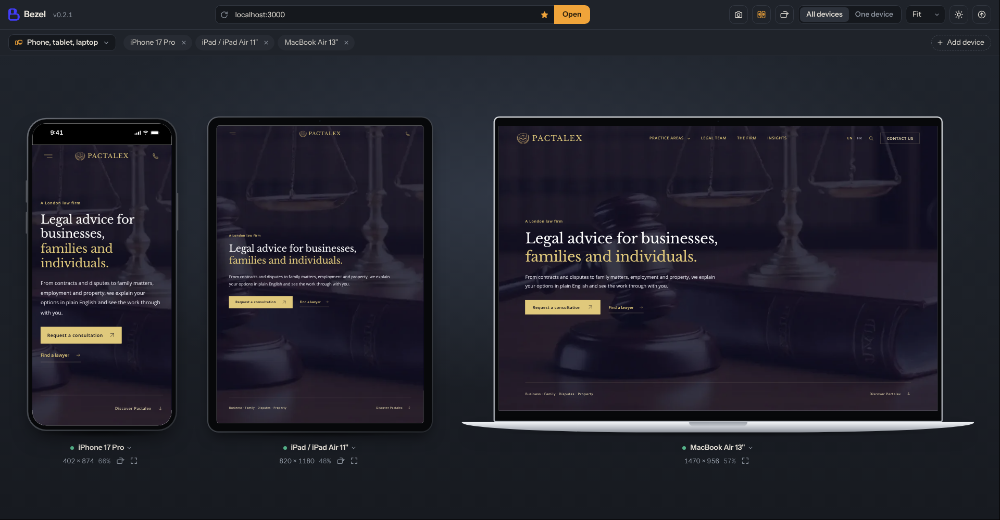

# Bezel

**See your website on every screen at once.**

Bezel is a browser-based tool for responsive web development. Point it at your local dev server and preview your site on phones, tablets, laptops, desktops and large screens side by side. You can switch devices with one click while you work.


<!-- Replace with a real screenshot once the UI is ready -->


---

## Features

- **Side-by-side preview**: mobile, tablet, laptop, desktop and large-screen views appear together, scaled to fit your window.
- **One-click device switching**: use the device bar or a keyboard shortcut to jump between devices without losing your place.
- **Focus mode**: click any frame to enlarge it, then go back to the full grid.
- **Device library**: includes presets for popular phones, tablets and monitors. You can add custom sizes and save them as your own presets.
- **Rotate**: switch any device between portrait and landscape.
- **Built for localhost**: works with `http://localhost:3000` or any local dev server. If your server has hot reload (Next.js, Vite, etc.), every frame updates when you save.
- **Live dimensions**: each frame shows its width × height so you always know which breakpoint you're looking at.

## How it works

Each device is an `<iframe>` set to that device's exact viewport size, then scaled down with CSS to fit on screen. Your site sees the real viewport width, so media queries, container queries and breakpoints behave as they would on the actual device.

## Device presets

| Category | Device | Viewport (CSS px) |
|---|---|---|
| Mobile | iPhone SE | 375 × 667 |
| Mobile | iPhone 15 | 393 × 852 |
| Mobile | Galaxy S24 | 360 × 780 |
| Mobile | Pixel 8 | 412 × 915 |
| Tablet | iPad (10th gen) | 820 × 1180 |
| Tablet | iPad Pro 12.9" | 1024 × 1366 |
| Laptop | Small laptop | 1366 × 768 |
| Laptop | MacBook Air 13" | 1440 × 900 |
| Desktop | Full HD | 1920 × 1080 |
| Large screen | QHD | 2560 × 1440 |
| Large screen | 4K | 3840 × 2160 |

Add your own from **Devices → Add custom size**.

## Getting started

Requirements: **Node.js 20+** and a modern browser (Chrome, Edge or Firefox)

```bash
git clone https://github.com/Zer0-red/bezel.git
cd bezel
npm install
npm run dev
```

Then open **http://localhost:5173** and enter your dev server's address, such as `http://localhost:3000`.

### Build

```bash
npm run build
```

This writes static files to `dist/`. Running Bezel locally next to your dev server works best. If you host it on a public domain, browsers may ask for permission before it can load `localhost` pages, or block them.

## Usage

1. Start your project's dev server as usual.
2. Type its URL in Bezel's address bar.
3. Choose which devices to show from the device bar.
4. Click a device to focus it, or press `Alt+0` to go back to the grid.
5. Use the rotate button to switch between portrait and landscape.

### Keyboard shortcuts

Shortcuts work while Bezel's own UI has focus. If you've been clicking inside a frame, click the toolbar first.

| Shortcut | Action |
|---|---|
| `/` | Focus the address bar |
| `Alt+1` – `Alt+5` | Jump to Mobile / Tablet / Laptop / Desktop / Large screen |
| `Alt+0` | Show all devices |
| `Alt+R` | Rotate the focused device |
| `Alt+Shift+R` | Reload all frames |

## Limitations

Bezel is built for testing your own sites during development. Because it uses iframes:

- **Sites that block framing won't load.** Many production sites send `X-Frame-Options` or a `frame-ancestors` CSP header that stops them from showing inside other pages. Your local projects usually don't, unless you've added those headers yourself.
- **Only the viewport size is emulated.** The user agent, pixel density and touch input stay those of your desktop browser. CSS breakpoints are accurate, but code that detects mobile from the user agent will still see a desktop.
- **Logins on other domains may not persist.** Browsers often withhold cookies from cross-site iframes.

For pixel-density or touch checks, use your browser's DevTools device mode on a single device.

## Roadmap

- [ ] Synced scrolling across all devices (via an optional helper script you add to your dev site)
- [ ] Synced clicks and navigation
- [ ] Screenshots for each device
- [ ] Save device sets per project
- [ ] Light and dark themes for the app UI
- [ ] Optional desktop build (Electron) for sites that block framing

## Contributing

Issues and pull requests are welcome. For larger changes, please open an issue first so we can discuss the approach.

1. Fork the repo
2. Create a branch: `git checkout -b feature/my-feature`
3. Commit your changes
4. Open a pull request

## License

MIT. See [LICENSE](LICENSE) for details.
